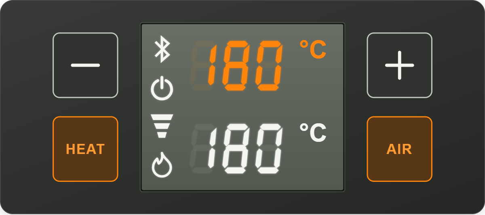

# Storz & Bickel Volcano Hybrid Integration for Home Assistant

[](https://github.com/hacs/default/blob/master/integration)
[](https://github.com/Chuffnugget/volcano_integration/releases)
[](https://github.com/Chuffnugget/volcano_integration/actions/workflows/validate.yaml)
[](https://github.com/Chuffnugget/volcano_integration/actions/workflows/hassfest.yml)
[](https://github.com/Chuffnugget/volcano_integration/releases)
[](https://github.com/Chuffnugget/volcano_integration/blob/master/LICENSE)
[](https://www.paypal.me/chuffnugget)

<a href="https://coff.ee/chuffnugget" target="_blank">
  
</a>

Control a Volcano Hybrid over Bluetooth from Home Assistant. Set the temperature,
switch the heater and air pump, and run workflows as Home Assistant scripts.
Home Assistant keeps the Bluetooth connection open, so a workflow can continue
after you close the app on your phone.

## What's new in 4.0.0

Changes since [3.2.4](https://github.com/Chuffnugget/volcano_integration/releases/tag/v3.2.4).



### Dashboard card and device settings

- Added a dashboard card based on the Hybrid's control panel. It shows the current
  and target temperatures, with buttons to adjust the temperature and turn the heat
  and air on or off. It follows the Volcano's °C or °F setting, fits on mobile and
  supports keyboard input. Each press of + or − changes the target by one degree.
- Add it from **Edit dashboard → Add card → Volcano Hybrid**, then select your
  device. That's all the setup it needs. The integration adds the resource for you,
  including on YAML dashboards.
- The card works with renamed entities and multiple Volcanos. It shows dashes for
  missing readings, disables controls that aren't available, and tells you if a
  command fails or isn't confirmed. Heat and air stay in sync with the device.
- Added a vibration switch to the device page. It changes only the vibration
  setting, then reads it back to check that the change took effect.
- Added **Temperature unit** under Configuration on the device page. It changes
  the setting on the Volcano itself. Changes made on the Volcano update HA too.
- All card colours can be changed in the card editor. Leave them as they are for
  the original appearance, or use **Reset colours** to restore it.

### Bluetooth

- Connections and discovery now go through Home Assistant's Bluetooth system.
  This allows local adapters and active ESPHome Bluetooth proxies to be used.
  Each reconnect checks for an available adapter or proxy again.
- You can enter the Bluetooth address manually if the Volcano isn't found during
  setup. Duplicate addresses are rejected, regardless of capitalisation.
- Switched to `bleak-retry-connector` and fixed the warning spam when a Volcano is
  unplugged or out of range. Retries start at five seconds and double up to five
  minutes. Expected connection failures go in the debug log.
- Disconnect now turns off heat and air and checks they're off before closing
  Bluetooth. It also cancels pending connections and retries. The power button
  on the card does the same.
- A dropped connection clears the old readings and starts reconnecting, unless
  you've asked it to disconnect.
- Connect waits for the initial readings and status updates to be set up before
  the next action runs. The timeout is now 180 seconds by default, adjustable
  from 1 to 900 seconds.

### Actions and readings

- Added `device_id` to all actions so scripts can control a specific Volcano.
  You can leave it out if you only have one. With multiple Volcanos, you must pick
  one. An invalid selection returns an error.
- Failed commands now stop the script with an error. Previously, a failed write
  or a disconnected device could leave the script running through the next steps.
  Connection and temperature timeouts also return errors.
- Fixed temperature waits completing from old readings. They now need a new
  reading from the same connection. Changing the target or disconnecting cancels
  the wait, and invalid readings can't complete it.
- Setting the temperature through an action now updates the number control and
  card too. Changes made on the Volcano are read back about every five seconds.
- Temperature controls use whole degrees in the Volcano's selected unit. The card
  shows the same unit as the device, regardless of HA's display preferences.
  Existing `set_temperature` actions still take Celsius. Temperature waits use
  the full reading so they don't finish early.
- Fixed the pump sometimes showing ON when it was off. Heat and pump status now
  use the correct flags from the device. Status is read when connecting, and an
  older reading can no longer overwrite a newer update.
- Auto-shutoff now uses the same 30–360 minute range in both the action and the
  number control, with one-minute steps.
- Brightness, shutoff, vibration and running time now refresh about once a minute
  while connected. Brightness reads both bytes of the device value; incomplete or
  invalid readings show as unknown.
- Updated the stop-script example to cancel workflows before turning off the
  heater and pump. It still tries to turn off the pump if the heater command fails.

### Other fixes and changes

- Actions now respect Home Assistant user permissions, just like the device's
  buttons and number controls. Read-only users can't send commands.
- Reloading or removing the integration, failed setup and HA shutdown now stop
  the connection tasks and release Bluetooth. Multiple connection tasks can no
  longer start for the same device, reads and writes take turns, and messages
  arriving from an old connection are ignored.
- Entities now share their readings instead of each handling updates separately.
  The device page shows the Volcano's firmware version. Firmware details are
  updated when read, rather than every time a sensor changes. Fixed the firmware
  lookup warning on newer versions of HA.
- Added **Download diagnostics**. The report leaves out the Bluetooth address
  and device name and hides the serial number. The Bluetooth status sensor also
  has a `connection_requested` attribute to show whether retries are still running.
- If the card fails to load, the device entities and actions still work. Removing
  the last Volcano removes the card resource; adding one again restores it.
- Home Assistant now supplies the Bluetooth libraries, so the integration no
  longer installs its own version of Bleak. Requires HA 2024.11 or newer.
- Releases now include a ZIP for HACS, allowing it to show download counts.
  The README badge shows the total downloads across release assets.
- Added Python tests for the minimum and current HA test environments, browser
  tests for the card, linting and packaging checks. These run in CI and again
  before a release ZIP is uploaded. The release tag must match the manifest
  version. Hassfest checks are still included.

## Installation

Requires Home Assistant **2024.11 or newer** and a supported Bluetooth adapter or
an [ESPHome Bluetooth proxy](https://esphome.io/components/bluetooth_proxy/) with
active connections enabled. The adapter or proxy must be in range of the Volcano.
A connected Volcano uses one proxy connection slot.

1. Find **Volcano Integration** in HACS and install it.
2. Restart Home Assistant.
3. Go to **Settings → Devices & services → Add integration → Volcano Integration**.
   Select your Volcano, or enter its Bluetooth address if it isn't discovered.

[](https://my.home-assistant.io/redirect/hacs_repository/?owner=chuffnugget&repository=volcano_integration&category=integration)

For manual installation, copy `custom_components/volcano_integration` from this
repository into `/config/custom_components/`, then follow steps 2 and 3.

### Updating from 3.2.4

Update through HACS, restart Home Assistant and refresh your browser or Companion
app. **You don't need to delete or re-add your Volcano.** Your devices and all
19 existing entities keep their IDs, and the action names haven't changed. Any
names you've set yourself are kept too. Vibration and Temperature unit appear as
new configuration controls.

You'll need Home Assistant **2024.11 or newer**. If any scripts set auto-shutoff
below 30 minutes, update them to use the **30–360 minute** range. Failed commands
and timeouts now stop the script with an error.
Disconnect now turns off heat and air before closing Bluetooth.

## Controls


On the device page:

| Control or reading | Details |
| --- | --- |
| Target temperature | 40–230 °C / 104–446 °F, rounded to a whole degree in the device's unit |
| Temperature unit | Configuration selector; changes °C / °F on the Volcano itself |
| Heater and air pump | On/off buttons and status sensors |
| Display brightness | 0–100% |
| Auto-shutoff | 30–360 minutes |
| Vibration | Configuration switch |
| Bluetooth | Connect/disconnect buttons and connection status |
| Device information | Current temperature, firmware versions, serial number and operating time |

Press **Connect** to connect to the Volcano. If it isn't available, the integration
keeps trying, leaving more time between attempts. **Disconnect** stops the retries
or, if connected, turns off the heater and pump before disconnecting. Both are
checked before the connection closes. If either fails, you'll get an error and
the connection stays open so you can retry. If Bluetooth has already dropped,
check the physical controls: Home Assistant can't turn them off without a connection.

### Hybrid dashboard card


Edit your dashboard, choose **Add card → Volcano Hybrid**, and select your device.
The card is included. You don't need to install anything else or add a resource.

- **− / +** lowers or raises the target by 1 °C or 1 °F, matching the Volcano.
- **HEAT / AIR** turns the heater or pump on and off. The button lights up when on.
- **Power** connects to the Volcano. When connected, it turns off heat and air
  before disconnecting. Tap it while connecting to cancel.

The card uses the Volcano's own °C / °F setting. Change **Temperature unit** under
Configuration on its device page, or use the physical controls. HA's temperature
preferences don't change what the card displays.

The symbols down the left are Bluetooth, power, air and heat. Bluetooth appears
when Home Assistant is connected. Air and heat appear when they're on.

Current temperature is at the top, target temperature underneath. Both show whole
degrees. The target display dims when heat is off. If there's no reading, you'll
see dashes. Errors appear below the panel.

Open the card editor to change the panel, display, button and status colours.
Each colour has its own picker. **Reset colours** restores the original appearance.

For YAML dashboards:

```yaml
type: custom:volcano-hybrid-card
device: YOUR_HOME_ASSISTANT_DEVICE_ID
```

Renamed entities and multiple Volcanos are supported.

Removing your last Volcano also removes the card resource. Deleting just the
resource is temporary: the integration adds it back when it next loads.

## Actions

Prefix each action below with `volcano_integration.`. If you have more than one
Volcano, use `device_id` to choose which one. You can leave it out if you only
have one.

| Action | Parameters |
| --- | --- |
| `connect` | `wait_until_connected`: defaults to `true`. `timeout`: 1–900 seconds, default 180. |
| `disconnect` | — |
| `heat_on` / `heat_off` | — |
| `pump_on` / `pump_off` | — |
| `set_temperature` | `temperature`: 40–230 °C. `wait_until_reached`: defaults to `true`. |
| `set_led_brightness` | `brightness`: 0–100%. |
| `set_auto_shutoff_setting` | `minutes`: 30–360. |

For example:

```yaml
action: volcano_integration.set_temperature
data:
  device_id: YOUR_HOME_ASSISTANT_DEVICE_ID
  temperature: 190
  wait_until_reached: true
```

The `set_temperature` action always takes Celsius and rounds to a whole °C,
so existing scripts keep working. With `wait_until_reached`, it waits for a new reading
at or above the target. It stops with an error if the target changes, the Volcano
disconnects or five minutes pass without reaching it. It won't wait for cooling.

The Connect timeout includes initial device readings. If it expires, the action
fails but connection retries continue. Use Disconnect to cancel them.

## Workflows

This example heats from 170 °C to 200 °C in 5 °C steps and runs the pump for five
seconds at each step. It assumes one configured Volcano; add `device_id` to each
integration action if you have more than one.

```yaml
alias: Volcano Workflow 1
sequence:
  - action: volcano_integration.connect
    data:
      wait_until_connected: true
  - action: volcano_integration.heat_on
    data: {}
  - action: volcano_integration.set_temperature
    data:
      temperature: 170
      wait_until_reached: true
  - action: volcano_integration.pump_on
    data: {}
  - delay:
      seconds: 5
  - action: volcano_integration.pump_off
    data: {}
  - action: volcano_integration.set_temperature
    data:
      temperature: 175
      wait_until_reached: true
  - action: volcano_integration.pump_on
    data: {}
  - delay:
      seconds: 5
  - action: volcano_integration.pump_off
    data: {}
  - action: volcano_integration.set_temperature
    data:
      temperature: 180
      wait_until_reached: true
  - action: volcano_integration.pump_on
    data: {}
  - delay:
      seconds: 5
  - action: volcano_integration.pump_off
    data: {}
  - action: volcano_integration.set_temperature
    data:
      temperature: 185
      wait_until_reached: true
  - action: volcano_integration.pump_on
    data: {}
  - delay:
      seconds: 5
  - action: volcano_integration.pump_off
    data: {}
  - action: volcano_integration.set_temperature
    data:
      temperature: 190
      wait_until_reached: true
  - action: volcano_integration.pump_on
    data: {}
  - delay:
      hours: 0
      minutes: 0
      seconds: 5
      milliseconds: 0
  - action: volcano_integration.pump_off
    data: {}
  - action: volcano_integration.set_temperature
    data:
      temperature: 195
      wait_until_reached: true
  - action: volcano_integration.pump_on
    data: {}
  - delay:
      seconds: 5
  - action: volcano_integration.pump_off
    data: {}
  - action: volcano_integration.set_temperature
    data:
      temperature: 200
      wait_until_reached: true
  - action: volcano_integration.pump_on
    data: {}
  - delay:
      seconds: 5
  - action: volcano_integration.pump_off
    data: {}
  - action: volcano_integration.heat_off
    data: {}
description: "A full workflow from 170C to 200C, with 5 second pumps between every 5C."
mode: restart
```

To stop a workflow, cancel the script before sending the off commands. Add all
your Volcano workflow scripts to the list below. `continue_on_error` allows the
pump-off action to run even if the heater-off action fails.

```yaml
alias: Volcano Stop All Scripts
sequence:
  - action: script.turn_off
    target:
      entity_id:
        - script.volcano_workflow_1
  - action: volcano_integration.heat_off
    continue_on_error: true
  - action: volcano_integration.pump_off
description: "Stops all Volcano scripts and turns off the heat/pump."
mode: restart
```

Do not leave the Volcano running unattended. If Bluetooth is unavailable, use
the physical controls to turn off the heater and pump.

## Troubleshooting

- **Can't connect:** check that Home Assistant recognizes your adapter or proxy,
  the Volcano is in range, and an active proxy connection slot is available.
- **Card missing after an update:** restart Home Assistant and refresh the browser
  or Companion app. Check the logs for card registration errors.
- **Unexpected readings:** temperature updates about once a second; the target
  and device unit refresh about every five polls. Unit changes also use device
  notifications when available. Other settings and operating-time counters
  refresh about once a minute while connected.

For connection problems, enable debug logging for
`custom_components.volcano_integration`. The integration's **Download diagnostics**
option excludes the Bluetooth address and device name and redacts the serial number.
Include your Home Assistant version and adapter/proxy details in a
[bug report](https://github.com/Chuffnugget/volcano_integration/issues).

## Contributing

Pull requests and bug reports are welcome.

The `test_*.py` files are automated tests run by pytest. Card tests use Playwright
in a browser. GitHub Actions runs both on pushes and pull requests, and before
uploading a release ZIP. They aren't installed or run on your Home Assistant.

HACS and hassfest also validate the integration on pushes, pull requests and
daily. Both can be run manually from the Actions tab. Dependabot checks for
GitHub Actions updates each week and opens a pull request when updates are available.

Run the Python tests on Linux or WSL with Python 3.14:

```sh
python -m venv .venv
. .venv/bin/activate
pip install -r requirements-test.txt
ruff check .
ruff format --check .
pytest -q --timeout=30
```

To test the minimum Home Assistant version, use a separate Python 3.12 environment
with `requirements-test-min.txt`. Tests simulate Bluetooth; changes to device
commands also need checking on a real Volcano.

Card tests and a local preview use Node 22 and pnpm 10:

```sh
pnpm install --frozen-lockfile
pnpm exec playwright install chromium
pnpm test
pnpm preview
```

The preview runs at `http://127.0.0.1:8765` with a simulated device.

### Releases

Set the version in `custom_components/volcano_integration/manifest.json` and use
a matching GitHub tag, such as `v4.0.0`. Publishing a release runs the checks,
builds `volcano_integration.zip` and attaches it to the release. Check that the
workflow succeeds and the asset is attached before announcing it.

For a local ZIP, run `python scripts/package_release.py --tag v4.0.0`. The output
is `dist/volcano_integration.zip`.

HACS uses release-asset download counts. The README badge totals downloads across
releases; these include updates and direct ZIP downloads, not unique installations.

Thanks to [bpinson999](https://github.com/bpinson999) for reporting the log spam when
the Volcano is unplugged and testing a fix in [PR #6](https://github.com/Chuffnugget/volcano_integration/pull/6).
